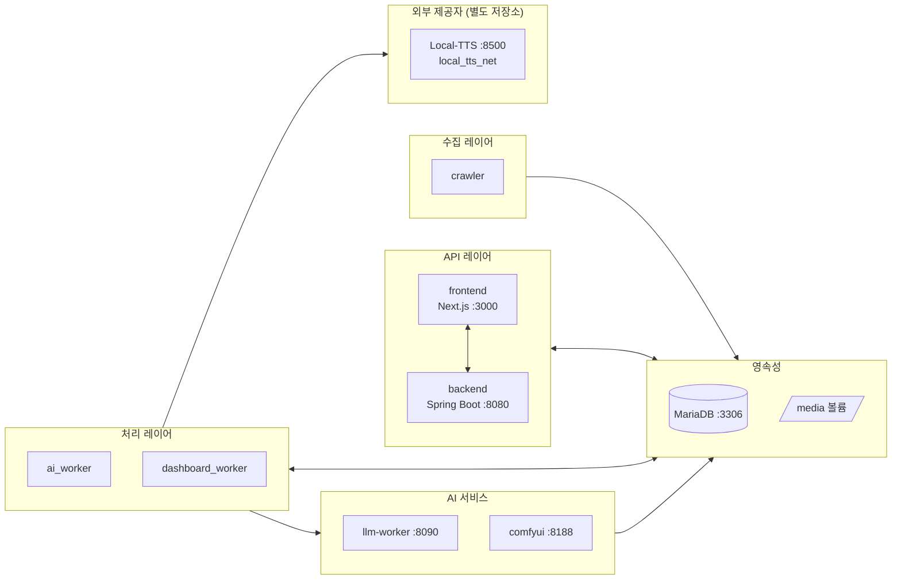
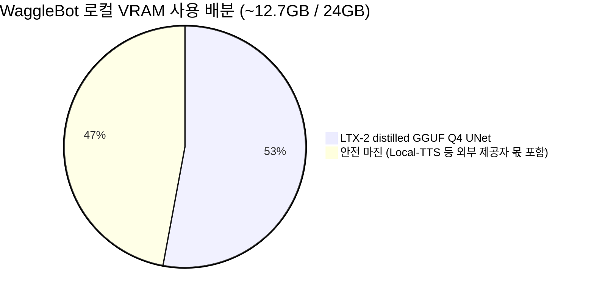
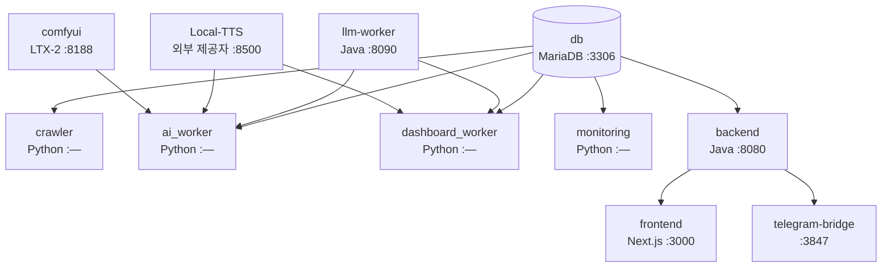
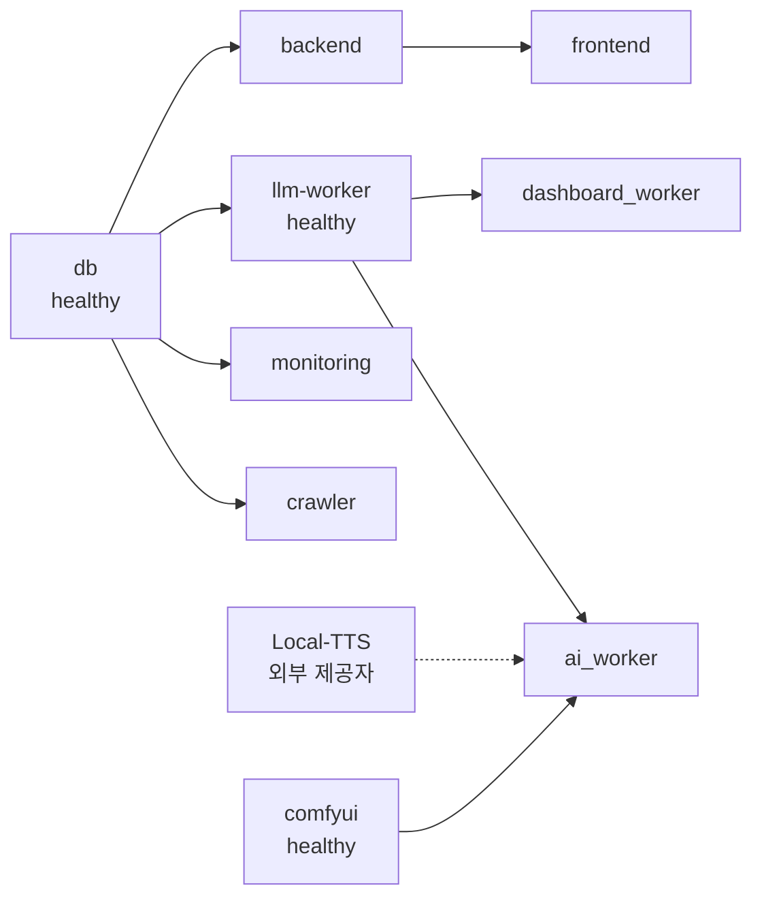

# WaggleBot — 컨테이너 토폴로지 (L2)

> last-verified: 2026-11-27 · code-ref: `env/docker-compose.yml`
> scope: Docker 서비스 포트·볼륨·환경변수·의존성·GPU 배분 — SSOT

## 서비스 레이어 구조

<!-- last-verified: 2026-11-27 -->
<!-- code-ref: env/docker-compose.yml -->



## GPU VRAM 배분 (RTX 3090 24GB)

<!-- last-verified: 2026-11-27 -->
<!-- code-ref: env/docker-compose.yml -->



> TTS(Local-TTS, Supertonic)는 WaggleBot 컨테이너가 아니라 별도 저장소(`/home/justant/Data/Local-TTS`)가 운영하는 외부 제공자이며 VRAM 소량만 쓴다. WaggleBot은 TTS용 VRAM 예산·GPU 핸드오프·컨테이너 제어를 갖지 않는다([ADR-0006](90-adr/0006-local-tts-provider.md)).
> Gemma-3-12B 텍스트 인코더(~15GB)는 `--lowvram` 플래그로 CPU에서 실행 (VRAM 미사용).

## 기술 스택

| 영역 | 기술 |
|------|------|
| **크롤러** | Python 3.12, aiohttp, BeautifulSoup |
| **백엔드** | Java 21, Spring Boot 3.3, MariaDB 11, Flyway |
| **프론트엔드** | Next.js 14 (App Router), TypeScript |
| **LLM 게이트웨이** | Java 21, Spring Boot 3.3, Claude CLI subprocess |
| **LLM** | Claude haiku-4-5 / sonnet-4-6 — CLI 백엔드(구독) 또는 API 백엔드(`ANTHROPIC_API_KEY`) |
| **TTS** | Local-TTS 제공자(Supertonic, 보이스 프리셋 M1~M5·F1~F5, 서버 정규화·프로필, ADR-0006~0008) |
| **비디오** | ComfyUI + LTX-2 19B distilled GGUF Q4 (8-step) |
| **렌더링** | FFmpeg (h264_nvenc) |
| **컨테이너** | Docker Compose, NVIDIA Container Runtime |
| **DB** | MariaDB 11, SQLAlchemy (Python), JPA/Hibernate (Java) |

---

## 서비스 의존성 그래프

<!-- last-verified: 2026-11-27 -->
<!-- code-ref: env/docker-compose.yml -->



---

## 서비스 상세

### db (MariaDB 11)
- **역할:** 중앙 영속성 저장소
- **포트:** `3306`
- **볼륨:** `mariadb_data:/var/lib/mysql` (named volume, 영구)
- **헬스체크:** `mariadb-admin ping` (10s interval, 5회 retry)
- **환경변수:** `MARIADB_DATABASE=wagglebot`, `MARIADB_USER=wagglebot`
- **모든 서비스의 시작 전제조건** (`service_healthy`)

---

### llm-worker (Java Spring Boot)
- **역할:** Claude CLI subprocess 게이트웨이. Python ai_worker의 모든 LLM 호출을 처리
- **소스:** `worker/llm/` (완전 구현)
- **포트:** `8090`
- **사용자:** `uid:gid = 1000:1000` (호스트 justant 사용자와 동일, 파일 소유권 유지)
- **HOME 환경변수:** `/home/justant` (Claude CLI 인증 토큰 관리 경로)
- **중요 볼륨:** `~/.claude:/home/justant/.claude` — Claude CLI 구독 인증 (host justant 사용자 소유 유지)
- **헬스체크:** `wget -qO- http://localhost:8090/healthz` (30s, 5회)
- **재시도 정책:** 
  - ClaudeService 내부 3회 지수 백오프 (1s, 2s, 4s 지연)
  - 인증/권한 오류 감지 시 즉시 실패 (무의미한 재시도 차단)
  - 의존: ~/.claude/.credentials.json 소유권 = 1000:1000 필수 (자동 refresh 시 보존)
- **주요 설정:**
  ```
  LLM_DEFAULT_MODEL=claude-haiku-4-5-20251001
  LLM_REPORT_MODEL=claude-sonnet-5-5
  LLM_POOL_SIZE=100
  LLM_QUEUE_CAPACITY=500
  CAVEMAN_DEFAULT_MODE=off
  ```
- **`CAVEMAN_DEFAULT_MODE=off` 이유:** `~/.claude` 마운트로 호스트의 Claude Code 플러그인·훅이 컨테이너 CLI에도 로드된다. 호스트에 caveman 플러그인(응답 압축 문체)이 기본 켜짐으로 설치돼 있어, 운영 생성물에 섞이지 않게 컨테이너에서는 꺼 둔다. 플러그인 자체의 비대화형(`claude -p`) 가드에 더한 두 번째 안전장치다(2026-11-28).
- **Dockerfile:** JDK21 빌드 → JRE21 + Node.js/npm + claude CLI 설치

---

### crawler (Python)
- **역할:** 커뮤니티 사이트 크롤링, Post/Comment DB 저장
- **소스:** `worker/` (Dockerfile), `python main.py` 실행
- **볼륨:** `../worker:/app`, `../config:/app/config`
- **환경변수:**
  ```
  DATABASE_URL=mysql+pymysql://wagglebot:...@db/wagglebot
  CRAWL_INTERVAL_HOURS=1
  ```
- **크롤러 플러그인:** `worker/crawlers/` — nate_pann, bobaedream, dcinside, fmkorea, **instiz, theqoo, mlbpark**
- **동적 사이트 목록:** `CrawlerRegistry.list_crawlers()` (하드코딩 금지)
- **환경변수 (Telegram 알림):**
  ```
  TELEGRAM_CRAWL_ALERT=false        # true로 설정하면 고점수 게시글 즉시 알림
  TELEGRAM_ALERT_THRESHOLD=100      # 이 점수 이상이면 알림 발송
  TELEGRAM_HOOK_URL=http://telegram-bridge:3847/hook
  ```

---

### ai_worker (Python)
- **역할:** 8-Phase AI 파이프라인 실행 루프 (`python -m ai_worker.core.main`)
- **소스:** `worker/` (Dockerfile)
- **볼륨:**
  - `../worker:/app`
  - `../assets/media:/app/media`
  - `/usr/lib/wsl/lib:/usr/lib/wsl/lib:ro` (WSL2 NVENC 라이브러리)
- **GPU:** NVIDIA 전체 장치 + `NVIDIA_DRIVER_CAPABILITIES=all`
- **환경변수:**
  ```
  LLM_WORKER_URL=http://llm-worker:8090
  # Local-TTS 제공자 (외부 네트워크 local_tts_net, 별칭 local-tts) — dashboard_worker와 동일 값
  TTS_SERVER_URL=http://local-tts:8500
  TTS_SERVER_TOKEN=            # 서버가 LOCAL_TTS_TOKEN을 요구할 때만 (.env에서만 읽음)
  TTS_SERVER_TIMEOUT_SEC=120   # 요청 1건 read 타임아웃
  TTS_SERVER_RETRIES=3         # 연결·429·503 추가 재시도
  TTS_SERVER_MAX_WAIT_SEC=3600 # job 완료 대기 상한(연결 실패는 이 시간을 쓰지 않음)
  TTS_PROFILE=wagglebot/shorts-ko
  TTS_CLIENT_ID=wagglebot      # X-Client-Id = 프로필 네임스페이스
  TTS_SPEED=1.1                # 서버 speed 옵션으로만 전달 (로컬 atempo 없음)
  COMFYUI_URL=http://comfyui:8188
  VIDEO_GEN_ENABLED=false   (기본값, true로 변경 시 Phase 4.5~7 활성화)
  # comfyui는 compose profile `video-gen` — VIDEO_GEN=false면 기본 up에서 제외
  # TTS 컨테이너·docker.sock·group_add 없음 — WaggleBot은 합성 요청만 보낸다 (ADR-0006)
  DATABASE_URL=...
  MEDIA_DIR=/app/media
  ```
- **종료 유예:** `stop_grace_period: 120s` (진행 중인 파이프라인 보호)
- **depends_on:** db, llm-worker (healthy). comfyui는 `required: false`(profile video-gen). Local-TTS는 compose 의존이 아니다 — 서버 불가 시 `ai_worker`가 APPROVED 집기를 보류한다([60-runtime](../worker/60-runtime.md))
- **네트워크:** `default` + 외부 `local_tts_net`(사전 생성 필수). TTS 서버 사설 주소는 `http://local-tts:8500`

---

### Local-TTS (외부 제공자 — 이 compose에 없음)
- **역할:** 한국어 TTS 합성·텍스트 정규화·청크·loudnorm을 제공하는 별도 저장소 서비스(`/home/justant/Data/Local-TTS`, 컨테이너 `local-tts`, Supertonic 엔진). WaggleBot은 REST(`/v1/jobs`)로 요청만 보낸다. 상세 → [backend/50-api.md](../backend/50-api.md#local-tts-api-8500)
- **포트:** 컨테이너 네트워크 `local_tts_net` 별칭 `local-tts` 사내 `:8500`, 호스트 `127.0.0.1:8500`
- **네트워크 전제:** `local_tts_net`은 `external: true`라 **사전 생성** 필요(Local-TTS `ops/prepare_data.sh` 또는 `docker network create local_tts_net`). 없으면 `ai_worker`·`dashboard_worker` 기동이 실패한다. 이 네트워크에 합류하는 서비스는 `ai_worker`, `dashboard_worker` 둘뿐이다.
- **클라이언트 ID·프로필:** `X-Client-Id: wagglebot`, 발음 프로필 `wagglebot/shorts-ko`(v1) — 원본 `config/tts_profile/shorts-ko.yaml`, 업로드·검증·활성화는 `worker/tools/sync_tts_profile.py`
- **폐기된 것:** `fish-speech` 컨테이너(`8082→8080`), `/var/run/docker.sock` 마운트, `group_add: "989"`, `FISH_*` env, Flight-Brain Fish 게이트·임대(`ATOMIC_TTS_FISH_GATE_URL` 등), `assets/voices` 참조 음성 합성 사용. ADR-0005는 폐기됨.

---

### comfyui
- **역할:** LTX-2 19B distilled 비디오 생성 (GGUF Q4, 8-step)
- **소스:** `env/Dockerfile.comfyui` (커스텀 빌드) + `env/ltxvideo_patches.py` (자동 패치)
- **포트:** `8188`
- **GPU:** RTX 3090, VRAM ~12.7GB (GGUF Q4 UNet) — Gemma 텍스트 인코더는 CPU
- **볼륨:**
  - `../checkpoints/ltx-2:/comfyui/models/checkpoints` — connector 파일
  - `../checkpoints/diffusion_models:/comfyui/models/diffusion_models` — GGUF UNet
  - `../checkpoints/vae:/comfyui/models/vae` — VAE
  - `../checkpoints/text_encoders:/comfyui/models/text_encoders` — Gemma-3-12B
  - `../worker/ai_worker/video/workflows:/comfyui/custom_workflows`
  - `../assets/media/tmp/videos:/comfyui/output` ← ai_worker와 공유
- **필요 모델 파일:**

  | 파일 | 크기 | 경로 (host) | HF 소스 |
  |------|------|-------------|---------|
  | `ltx-2-19b-distilled_Q4_K_M.gguf` | 12.7GB | `checkpoints/diffusion_models/` | `Kijai/LTXV2_comfy` |
  | `ltx-2-19b-embeddings_connector_distill_bf16.safetensors` | 2.9GB | `checkpoints/ltx-2/` | `Kijai/LTXV2_comfy` |
  | `LTX2_video_vae_bf16.safetensors` | 2.4GB | `checkpoints/vae/` | `Kijai/LTXV2_comfy` |
  | `gemma-3-12b-it-qat-q4_0-unquantized/` | ~15GB | `checkpoints/text_encoders/` | `google/gemma-3-12b-it-qat-q4_0-unquantized` |

  > 27GB FP8 full checkpoint는 시스템 RAM(17GB) 부족으로 사용 불가.
  > Kijai의 pre-extracted connector 파일(2.9GB)로 대체.

- **실행 플래그:** `--lowvram --reserve-vram 2 --fp8_e4m3fn-text-enc`
  - `--lowvram`: Gemma 텍스트 인코더 CPU 오프로드 필수 (BF16 24GB → VRAM 초과)
  - `--reserve-vram 2`: 2GB 예약 (VRAM 안전 마진)
- **주의:** `--normalvram` 절대 금지 (텍스트 인코딩 OOM 발생)
- **시작 시간:** `start_period: 300s` (Gemma 모델 로딩 5분)
- **빌드 시 자동 패치** (`env/ltxvideo_patches.py`):
  - kornia 0.8.3 호환: `pyramid_blending.py` — `pad` 제거 → `F.pad()` 대체
  - standalone connector AV prefix 감지: `embeddings_connector.py`
  - `is_av` 판별 수정: `text_embeddings_connectors.py`

---

### backend (Spring Boot)
- **역할:** REST API 서버, Job 큐 관리, 대시보드 백엔드
- **소스:** `backend/` (완전 구현)
- **포트:** `8080`
- **볼륨:** `../config:/app/config`, `../assets/media:/app/media`
- **환경변수:**
  ```
  SPRING_DATASOURCE_URL=jdbc:mariadb://db:3306/wagglebot
  MEDIA_DIR=/app/media
  FRONTEND_URL=http://frontend:3000
  EXTERNAL_API_KEY=change-me-external   # /api/external/** 인증 키 (app.external.api-key)
  ```
- **외부 ingest API:** `/api/external/jobs` (Again Spring 등) — `ExternalApiKeyFilter`가 `X-Api-Key` 헤더 강제, 그 외 경로는 무영향. 상세 → [`50-api/rest-spec.md`](../backend/50-api.md#external-jobs-apiexternaljobs--외부-연동-ingestrender)

---

### frontend (Next.js 14)
- **역할:** 관리자 대시보드 UI
- **소스:** `frontend/` (완전 구현, 7개 어드민 페이지 운영 중)
- **포트:** `3000`
- **라우트 구조:**
  ```
  /admin/inbox        수신함 (COLLECTED 게시글)
  /admin/editor/[id]  편집실 (대본 수정/승인)
  /admin/gallery      갤러리 (완성 콘텐츠)
  /admin/progress     처리 진행 현황
  /admin/analytics    성과 분석
  /admin/llm-logs     LLM 호출 이력
  /admin/settings     파이프라인/업로더 설정
  ```
- **환경변수:** `BACKEND_URL=http://backend:8080`

---

### dashboard_worker (Python)
- **역할:** `jobs` 테이블 폴링, Java backend에서 enqueue한 작업 Python에서 실행
- **소스:** `worker/` Dockerfile, `python -m dashboard_worker.main`
- **볼륨:** `../worker:/app`, `../config:/app/config`, `../assets/media:/app/media`
- **환경변수:**
  ```
  DATABASE_URL=...
  LLM_WORKER_URL=http://llm-worker:8090
  TTS_SERVER_URL=http://local-tts:8500   # 대시보드 TTS 미리듣기용. ai_worker와 동일한 TTS_* 8종을 전달(재큐 변수 `TTS_REQUEUE_MAX`는 ai_worker만)(TOKEN·TIMEOUT·RETRIES·MAX_WAIT·PROFILE·CLIENT_ID·SPEED)
  MEDIA_DIR=/app/media
  ```

---

### monitoring (Python)
- **역할:** 시스템 헬스체크, 알림 발송
- **소스:** `worker/` Dockerfile, `python -m monitoring.daemon`
- **환경변수 (주요):**
  ```
  GPU_TEMP_WARNING=75    GPU_TEMP_CRITICAL=80
  GPU_VRAM_WARNING=85    GPU_VRAM_CRITICAL=95
  DISK_USAGE_WARNING=80  DISK_USAGE_CRITICAL=90
  SLACK_ALERTS_ENABLED=false
  EMAIL_ALERTS_ENABLED=false
  HEALTH_CHECK_INTERVAL=300  (5분)
  ```

---

### telegram-bridge
- **역할:** Telegram 봇 통한 원격 제어 인터페이스
- **소스:** `telegram/` 디렉토리
- **포트:** `3847` (HOOKS_PORT)
- **볼륨:** 프로젝트 루트 read-only + `_request`, `_result` 디렉토리 쓰기
- **환경변수:**
  ```
  TELEGRAM_BOT_TOKEN=...
  ALLOWED_USER_IDS=...
  ANTHROPIC_API_KEY=...
  DAILY_BRIEF_ENABLED=false
  ASM_TELEGRAM_CALLBACK_URL=http://100.115.252.61:8200/api/v1/telegram/callback
  ASM_BEARER_TOKEN=...
  ```
- **ASM(Again-Spring-Marketing) 콜백 forwarder:** `redrive:`/`ignore:` 접두사의
  `callback_query`만 Tailscale 경유로 ASM(`100.115.252.61:8200`)에 그대로
  전달(dumb pipe) — 필드 개수 등 payload 형태는 검증하지 않는다. idempotency·
  만료·legacy 거부 등 정책은 ASM이 소유. ASM에는 이 봇 토큰의 `getUpdates`
  poller가 없음(이 컨테이너가 단독 소비, 409 회피) — redrive/ignore 버튼도
  ASM이 직접 Bot API로 전송하고, 클릭 결과만 이 브리지가 중계한다.
---

## 볼륨 / 네트워크

```
볼륨:
  mariadb_data          - MariaDB 데이터 (named, Docker 관리)

공유 마운트 경로:
  ../assets/media/tmp/videos  ← comfyui output ↔ ai_worker 공유 (핵심)
  ../assets/voices            ← 보이스 미리듣기 샘플(voice_preview_<KEY>.mp3, backend 읽기 전용)
  ../checkpoints/             ← 모델 가중치 (ltx-2 등)
  ../config/                  ← Python 설정 (crawler, ai_worker, dashboard_worker)
  ~/.claude                   ← Claude CLI 인증 (llm-worker 전용)

네트워크:
  기본 bridge 네트워크 (서비스명으로 DNS 해석)
  local_tts_net (external, 사전 생성 필요): ai_worker·dashboard_worker가 Local-TTS(local-tts:8500)에 접속
  ai_worker: extra_hosts - host.docker.internal:host-gateway (WSL2 호스트 접근)
```

## 시작 순서

<!-- last-verified: 2026-11-27 -->
<!-- code-ref: env/docker-compose.yml -->


