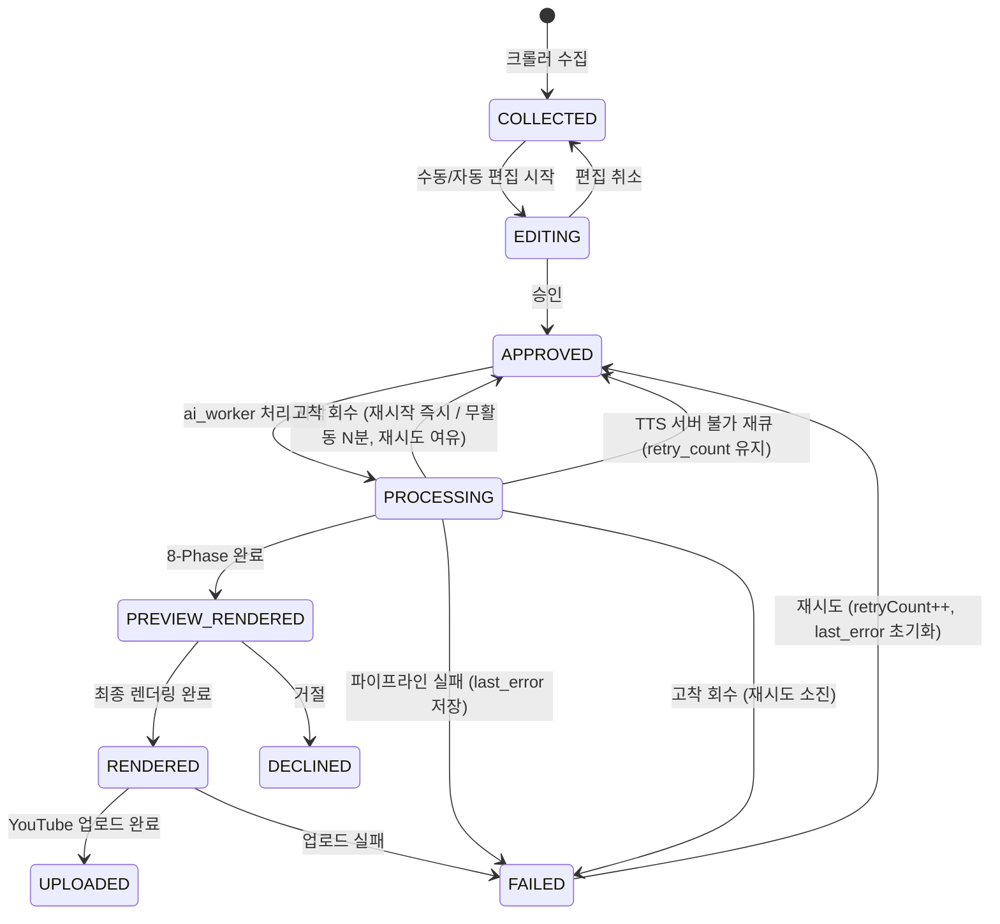

# WaggleBot — Post 상태 전이

> last-verified: 2026-11-27 · code-ref: `worker/db/models.py`, `worker/ai_worker/core/processor.py`
> scope: Post 상태 머신 — SSOT

## 상태 전이 다이어그램

<!-- last-verified: 2026-11-27 -->
<!-- code-ref: worker/db/models.py, worker/ai_worker/core/processor.py -->

## 상태별 의미

| 상태 | 의미 | 진입 트리거 |
|------|------|-----------|
| `COLLECTED` | 크롤러가 저장한 원시 게시글 (수신함) | 크롤러 자동 수집 |
| `EDITING` | 수신함 승인 후 편집실 대기 | `POST /api/inbox/{id}/approve` |
| `APPROVED` | 편집 확인 완료, AI 처리 대기 | `POST /api/editor/{id}/confirm` |
| `PROCESSING` | ai_worker 8-Phase 실행 중 | ai_worker 폴링 시 자동 전환 |
| `PREVIEW_RENDERED` | 저화질 프리뷰 렌더링 완료 | 8-Phase 성공 |
| `RENDERED` | HD 렌더링 완료, 업로드 대기 | `POST /api/gallery/{id}/hd-render` Job |
| `UPLOADED` | YouTube 업로드 완료 (종착) | `POST /api/gallery/{id}/upload` Job |
| `DECLINED` | 운영자 거절 | `POST /api/inbox/{id}/decline` 또는 PREVIEW에서 거절 |
| `FAILED` | 처리 실패 (`last_error` 저장, `retry_count` 증가) | 파이프라인/업로드 예외 |

## 재시도 정책

- `MAX_RETRY_COUNT = 3` — 초과 시 영구 FAILED
- **PROCESSING 고착 회수** (`worker/ai_worker/core/recovery.py`): 워커 시작 시 모든 PROCESSING을, 이후 `STALE_SCAN_INTERVAL_SEC`(60s)마다 `STALE_PROCESSING_MINUTES`(30분) 넘게 무활동(`progress.last_heartbeat_at`·`posts.updated_at` 중 최근 값)인 PROCESSING을 회수한다. `retry_count < MAX_RETRY_COUNT`면 `APPROVED` 재큐, 아니면 `FAILED`(`INFRA_STUCK_PROCESSING`, `last_error`에 사유). 현재 프로세스가 소유한 post는 제외하고 하트비트로 보호한다. 다만 단계 정체(`PHASE_STALL_SEC`, 기본 7200s 동안 진행 stamp 없음) inflight는 하트비트 갱신만 멈추고 경고하며, 소유 프로세스가 실행 중이므로 회수·취소는 하지 않는다. Local-TTS 서버가 불가(`TTSUnavailable`: 연결·타임아웃·429/503·큐 포화, `TTS_SERVER_MAX_WAIT_SEC` 대기 소진)하면 FAILED로 만들지 않고 `PROCESSING → APPROVED`(retry_count 유지)로 되돌린다. 집기 전 서버 확인이 실패하면 APPROVED 폴링 자체를 보류한다(상태 변화 없음). 서버가 영구 거부(요청 거부·job 영구 실패)하면 일반 실패 경로(FAILED)다.
- 일시 오류 자동 재시도는 없다(FAILED는 수동 retry만) — 폭주 방지. 예외는 TTS 서버 일시 장애로, FAILED가 아니라 APPROVED 재큐(retry_count 유지)로 처리한다([ADR-0006](90-adr/0006-local-tts-provider.md))
- `POST /api/progress/{id}/retry` → `FAILED → APPROVED`, `retryCount++`, `last_error = null`
- 실패 원인은 `Post.last_error` 컬럼에 저장, Progress 페이지에서 최근 20건 조회 가능

> 처리 루프 동작(폴링 간격·하트비트·실패 처리) → [`docs/worker/60-runtime.md`](../worker/60-runtime.md)
