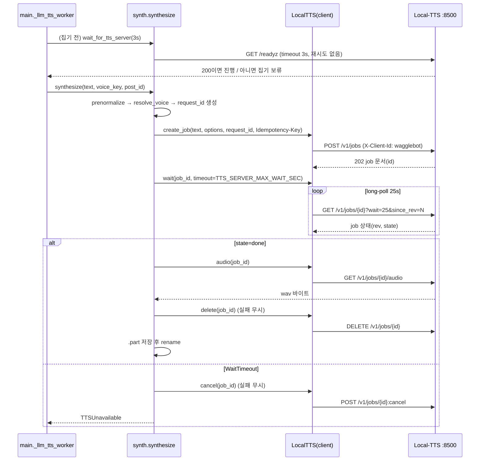

# WaggleBot — Local-TTS 요청·응답 처리 (클라이언트 계약)

> last-verified: 2026-11-27 (commit `70dbc00`) · code-ref: `worker/ai_worker/tts/local_tts_client.py`, `worker/ai_worker/tts/synth.py`, `worker/ai_worker/tts/voice_resolver.py`, `worker/ai_worker/core/tts_requeue.py`, `worker/ai_worker/core/main.py`, `worker/ai_worker/core/processor.py`, `config/settings.py`, `env/docker-compose.yml`
> scope: WaggleBot이 공용 Local-TTS 서버에 합성을 **요청하는 방법**과 **응답을 소비하는 방법** — SSOT. 서버 쪽 계약(전체 옵션·오류 코드·응답 스키마)은 Local-TTS 저장소의 `docs/api.md`(`/home/justant/Data/Local-TTS/docs/api.md`)가 정본이며 여기서는 복제하지 않는다.

[ADR-0006](../../shared/90-adr/0006-local-tts-provider.md)(제공자 모델)·[ADR-0007](../../shared/90-adr/0007-voice-presets.md)(보이스 프리셋)·[ADR-0008](../../shared/90-adr/0008-tts-normalization-standard.md)(정규화)의 구현 상세다. WaggleBot에는 합성 모델·게이트·GPU 임대·컨테이너 제어가 없고, 아래 HTTP 요청만 한다.

## 1. 구성 요소

| 파일 | 역할 |
|---|---|
| `worker/ai_worker/tts/local_tts_client.py` | Local-TTS 저장소 `client/local_tts_client.py`의 **복사본**(httpx 단일 파일). 직접 수정 금지(원본에서 통째로 재복사). HTTP·재시도·오류 계층·`wait()` |
| `worker/ai_worker/tts/synth.py` | 어댑터. `synthesize()`·`wait_for_tts_server()`·`TTSUnavailable`·`TTSError`. 옵션 조립, 호출 순서, 서버 오류 → 앱 예외 매핑 |
| `worker/ai_worker/tts/voice_resolver.py` | 보이스 키 → `M1..F5` 결정적 해석 |
| `worker/ai_worker/tts/prenorm.py` | 서버 전송 전 앱 고유 전처리(화자 접두어·URL·해시태그 등) |
| `worker/ai_worker/core/tts_requeue.py` | TTS 불가 연속 재큐 횟수·백오프(`posts.last_error` 마커) |
| `worker/ai_worker/core/main.py` | 집기 전 서버 확인(보류), 재큐 처리, 후보 선택 |
| `worker/ai_worker/tts/alignment.py` | 렌더 타이밍용 ASR 정렬(서버 응답 타이밍은 **쓰지 않음**) |

호출 진입점은 두 곳이다: ① LLM+TTS 단계(`processor._safe_generate_tts` — 사연 낭독 전체를 1건으로 합성), ② 렌더 단계 폴백/개별 합성(`renderer/_tts.py` `_tts_chunk_async` — closer·outro·댓글·채팅). 대시보드 TTS 미리듣기(`dashboard_worker/handlers.py` `_handle_tts_preview`)도 같은 `synthesize()`를 쓴다.

## 2. 호출 흐름

<!-- last-verified: 2026-11-27 -->
<!-- code-ref: worker/ai_worker/tts/synth.py, worker/ai_worker/tts/local_tts_client.py, worker/ai_worker/core/main.py -->



- 합성은 동기 httpx 클라이언트를 `asyncio.to_thread`로 감싸 실행한다(`synth._synthesize_blocking`). 호출마다 클라이언트를 새로 만들고(`_new_client`) 닫는다.
- 쓰는 엔드포인트: `POST /v1/jobs`, `GET /v1/jobs/{id}`(long-poll), `GET /v1/jobs/{id}/audio`, `DELETE /v1/jobs/{id}`, `POST /v1/jobs/{id}:cancel`, `GET /readyz`, 프로필 관리 일체(`worker/tools/sync_tts_profile.py`만). **쓰지 않는 것:** `/v1/jobs/{id}/chunks`, `/chunks/{i}/audio`, `/timings`, `:dry_run`(ADR-0008 측정용 도구만), `:resume`, `/v1/audio/speech`, `/v1/voices`.
- 오디오 수신 후 `delete`·실패 후 `cancel`은 모두 best-effort(예외 무시). 오디오 조회나 `wait` 중 연결 실패가 나면 서버 job은 정리되지 않고 서버 TTL에 맡긴다.

## 3. 요청

### 3.1 헤더

| 헤더 | 값 |
|---|---|
| `X-Client-Id` | `TTS_CLIENT_ID`(기본 `wagglebot`) — 프로필 네임스페이스(`wagglebot/*`)와 일치해야 한다 |
| `Authorization` | `Bearer <TTS_SERVER_TOKEN>` — 토큰이 비어 있으면 보내지 않음 |
| `Idempotency-Key` | `request_id`와 동일 |
| `X-Request-Id` | `request_id`와 동일 |
| `User-Agent` | `local-tts-client/1` |

`request_id = wb-<post_id|x>-<scene_type>-<uuid hex 8자>` — 호출(`synthesize`)마다 새로 만든다. 같은 호출 안의 500 재시도만 같은 값을 재사용한다.

### 3.2 본문 (`synth.build_options`)

```json
{
  "input": "<prenormalize 결과>",
  "options": {
    "voice": "F2",
    "lang": "ko",
    "speed": 1.1,
    "normalize": {"enabled": true, "profile": "wagglebot/shorts-ko"},
    "chunk": {"mode": "max_chars", "max_chars": 120},
    "postprocess": {"loudnorm": {"enabled": true, "i": -16, "tp": -1.5}},
    "output": {"format": "wav"},
    "request_id": "wb-123-image_text-1a2b3c4d"
  }
}
```

본문 키는 `input`(문자열)이다(`text`가 아님). 서버는 최상위 `request_id`를 받지 않으므로 클라이언트가 `options.request_id`로 옮긴다.

| 옵션 | WaggleBot 값 | 비고 |
|---|---|---|
| `voice` | `M1`~`M5`·`F1`~`F5` | `resolve_voice()` 결과(항상 프리셋). §4 |
| `lang` | `ko` | 고정 |
| `speed` | `TTS_SPEED`(1.1) | 서버 네이티브 속도 한 곳에서만 적용. 로컬 atempo·`postprocess.chunk.tempo` 금지(이중 적용 금지) |
| `normalize` | `enabled=true`, `profile=TTS_PROFILE`(`wagglebot/shorts-ko`) | `TTS_PROFILE`을 비우면 `profile` 키를 생략(서버 내장 정규화만). 버전 `@n`은 붙이지 않아 **active 버전**을 따른다 |
| `chunk` | `mode=max_chars`, `max_chars=120` | 청크 분할은 서버가 한다(로컬 분할 없음) |
| `postprocess.loudnorm` | `enabled=true`, `i=-16`, `tp=-1.5` | 서버 loudnorm. 로컬 트림·fade·gap·sample_rate는 지정하지 않는다 |
| `output.format` | `wav` | 샘플레이트는 지정하지 않음(서버 기본 사용, 앱 상수 `TTS_SAMPLE_RATE`=44100은 참고값) |

**보내지 않는 항목(= 서버 기본):** `steps`·`seed`·`cache`·`ttl_sec`·`lane`, `on_chunk_error`(서버 기본 `fail` — 문장 누락 방지), `postprocess.chunk.trim_silence`·`gap_ms`·`para_gap_ms`·`sample_rate`, `output.bitrate`·`return`·`timings`, `normalize.builtin`·`strip_unsupported`·`return_text`, 본문 `metadata`. 이들 기본값과 의미는 Local-TTS `docs/api.md`를 따른다.

### 3.3 대기·재시도 상수

| 항목 | 값 | 출처 |
|---|---|---|
| 요청 1건 read 타임아웃 | `TTS_SERVER_TIMEOUT_SEC`=120s | `_new_client` |
| connect 타임아웃 | 5s | 클라이언트 기본 |
| HTTP 재시도 | 첫 시도 이후 `TTS_SERVER_RETRIES`=3회. 대상: 연결 오류·타임아웃, 429, 503, 502/504 | 클라이언트 `_request` |
| HTTP 재시도 간격 | `Retry-After`가 있으면 그 값(상한 120s), 없으면 `min(30, 0.5·2^n)`의 equal jitter(0.25~0.5s, 0.5~1s, 1~2s) | `_delay` |
| 연결 오류 재시도 조건 | `Idempotency-Key`가 있을 때만(WaggleBot은 항상 있음). 429/503은 키 없이도 재시도 | `create_job(safe_retry=bool(key))` |
| 완료 대기 | `wait(job_id, timeout=TTS_SERVER_MAX_WAIT_SEC)`: long-poll 25s, 서버가 즉시 돌려주면 최소 1s 간격 | `synth._synthesize_once` |
| 최종 오디오 조회 timeout | `max(TTS_SERVER_TIMEOUT_SEC, 120)`s | `audio()` |
| 준비 확인 | `GET /readyz` 1회 3s timeout, 재시도 없음(`ready()`), `wait_for_tts_server`가 2s 간격으로 반복 | `synth` |

> **`TTS_SERVER_MAX_WAIT_SEC`(3600s)의 범위:** job **완료 대기**(`wait`)의 상한이다. 연결 실패·429·503은 이 시간을 쓰지 않는다 — 클라이언트 `TTS_SERVER_RETRIES`회 재시도(합계 수 초~수십 초, `Retry-After`가 길면 더)가 끝나는 즉시 `TTSUnavailable`이 된다. `wait_for_tts_server(timeout_sec=None)`는 이 값을 기본 상한으로 쓰지만, 실제 호출처는 모두 3초(`_TTS_PROBE_TIMEOUT_SEC`)를 명시 전달한다.

## 4. 보이스 해석 (`voice_resolver.resolve_voice(voice_key, post_id)`)

항상 `M1..F5` 중 하나를 돌려주는 순수 함수다. 같은 `(voice_key, post_id)`는 항상 같은 결과.

| 입력 | 결과 |
|---|---|
| 프리셋 키(`M1`~`F5`, 대소문자 무관) | 대문자로 그대로 |
| 구 키(Fish 참조 음성 등, `LEGACY_GENDER`에 있는 키) | **성별 보존**: `random.Random(post_id or 0)`로 같은 성별 5개를 섞은 순열에서 구 키의 고정 서수로 선택 |
| `None`·빈 값·**미지 키(`default` 포함)** | `post_id`가 있으면 `random.Random(post_id).choice(10종)` — **남녀 구분 없이 10종 전체**. `post_id`도 없으면 `F1` |

**`default`의 의미:** `default`는 구 키 목록에 없는 "미지 키"이므로 **성별과 무관하게 글마다(post_id 시드) 10개 프리셋 중 하나**로 정해진다(예: post 1~4 → M3·M1·M4·M4, 0·5·6 → F2·F5·F5). 남성 프리셋이라는 이전 서술은 틀렸다. `pipeline.json`의 `tts_voice`가 `default`이므로 운영 기본 동작은 "글마다 결정적 랜덤 1종"이다. `post_id` 없이 `default`를 해석하면 `F1`이다.

### 4.1 글당 1회 확정과 재사용 (70dbc00)

낭독 보이스는 `processor.llm_tts_stage`에서 **한 번** 프리셋으로 확정하고, 이후 모든 장면이 같은 값을 쓴다.

1. 원시 키 우선순위: `contents.variant_config.tts_voice`(외부 ingest·어드민 선택) > `contents.tts_voice` > `pipeline.json tts_voice` > `VOICE_DEFAULT("default")`. 이를 `resolve_voice(키, post_id)`로 프리셋화해 `ScriptData.narrator_voice`에 넣는다.
2. **TTS 호출 전에** `_persist_script_before_tts`가 대본(`contents.summary_text`)과 확정 프리셋(`contents.tts_voice`)을 저장한다. TTS 불가로 재큐돼도 다음 시도는 저장된 대본을 재사용(LLM 재호출 없음)하고 같은 프리셋을 쓴다.
3. 낭독 합성(`_safe_generate_tts`)은 확정 프리셋을 `voice_key`로 넘기고 디스크 TTS 캐시 키도 프리셋 기준이다(`프리셋:텍스트:speed:pp_v7`).
4. 렌더 단계: `SceneDirector`는 내레이터·댓글 풀·등장인물·채팅 발화자를 모두 `resolve_voice(키, post_id)`로 정규화해 보관하고(댓글 풀 제외 비교도 프리셋 기준), 렌더러(`render_layout_video*`, `_tts_chunk_async`)는 같은 `(키, post_id)`로 해석한 프리셋을 합성과 outro/댓글 캐시 키 양쪽에 쓴다. outro·댓글·폴백 장면이 낭독과 같은 목소리가 되는 이유다.

현재 코드 한계: `script.voice_assigner.pick_voice`는 항상 `VOICE_DEFAULT`(`default`)를 돌려주므로, 등장인물·채팅 발화자 보이스도 `resolve_voice("default", post_id)`가 되어 낭독 원시 키가 `default`인 글에서는 낭독과 같은 프리셋이 된다([ADR-0007](../../shared/90-adr/0007-voice-presets.md) 한계 항목).

### 4.2 UI·backend 보이스 카탈로그와의 관계

- `config/voices.json` v4(`key·label·gender·engine`, 10종)가 카탈로그 정본이다. backend `VoiceCatalogService`가 읽어 `GET /api/tts/voices`(`voices` + `defaultVoice`)로 제공하고, 샘플 mp3(`voice_preview_<KEY>.mp3`)는 `GET /api/tts/voices/{key}/sample`로 스트리밍한다.
- `VoiceCatalogService.isValidVoiceKey(key)`는 `null`(전역 기본 사용)과 카탈로그 프리셋 키만 허용한다. 즉 UI(편집실 `/api/editor` 미리듣기 등)는 프리셋만 보낼 수 있고, 구 키·`default` 같은 값은 외부 ingest(`ExternalIngestService`, `variant_config.tts_voice`)나 `pipeline.json`·기존 DB 값으로만 들어온다. 이런 값은 워커가 위 규칙으로 해석한다.
- `defaultVoice`는 `pipeline.json tts_voice`가 프리셋이면 그 값, 아니면(`default`·구 키) UI 표시용으로 `F1`을 돌려준다. **표시일 뿐 실제 합성 결과와 다를 수 있다**(`default`는 글마다 10종 중 하나). backend 설정 기본값(`SettingsService` `tts_voice`)도 `F1`이라, 설정 화면에서 저장하면 `pipeline.json tts_voice=F1`이 되어 이후 모든 글이 F1 고정이 된다.
- 미리듣기(`TTS_PREVIEW` job → `dashboard_worker._handle_tts_preview`): 보이스 우선순위가 `payload.voice > contents.tts_voice > pipeline.json tts_voice`(`variant_config`는 보지 않음)이며 `synthesize(..., post_id)`로 같은 규칙으로 해석한다. 장애 시 재큐 없이 job 실패로 끝난다.

## 5. 응답 소비

| 응답 | 소비 방식 |
|---|---|
| `POST /v1/jobs` 202(또는 멱등 재생 200) | `job["id"]`만 사용 |
| `GET /v1/jobs/{id}` | `wait()`가 `state`를 폴링. `done`이면 마지막 job 문서 반환, `failed`→`JobFailed`, `cancelled`→`JobCancelled`(`JobFailed` 하위). 앱이 읽는 필드는 `result.duration_sec`(완료 로그용)뿐이며 `on_progress`·`progress`·`queue`·`warnings`·`resolved`는 쓰지 않는다 |
| `GET /v1/jobs/{id}/audio` | wav 바이트를 `<out>.part`에 쓴 뒤 rename. 이후 `processor`가 1KB 미만이면 실패로 본다 |
| `chunks[]`·`/timings` | **호출하지 않는다** |

**씬 타이밍은 현재도 ASR 기반이다.** 사연 낭독(hook·body)은 `narration`(`script.to_narration_text()`) 전체를 서버에 **1건**으로 합성하고, 렌더러(`_generate_tts_chunks`)가 이 wav를 `alignment.align_narration_lines`(faster-whisper 단어 타임스탬프)로 줄 단위 발화 시작 시각에 정렬해 잘라 쓴다(`WHISPER_*`·`TTS_ALIGNMENT_*` 설정, CPU). 정렬이 실패하면 장면별 개별 TTS로 폴백한다. closer·댓글·채팅·outro는 장면별로 따로 합성하고 길이는 받은 wav에서 측정한다. 서버 `chunks[]`/`timings`로 전환하는 것은 후속 과제다.

## 6. 오류 분류

서버·클라이언트 예외 → `synth` 예외 → 호출처 동작.

| 상황 | 클라이언트 예외 | synth 예외 | 처리 |
|---|---|---|---|
| 연결 실패·타임아웃(재시도 소진) | `ConnectionFailed`·`RequestTimeout` | `TTSUnavailable` | 일시 장애 → 재큐 |
| 429 `queue_full` | `RateLimited` | `TTSUnavailable` | 〃 |
| 503 `model_loading`·`no_gpu` | `Unavailable` | `TTSUnavailable` | 〃 |
| 502·504(게이트웨이) | `ServerError`(status 502/504) | `TTSUnavailable` | 〃 (클라이언트가 먼저 재시도) |
| 완료 대기 초과 | `WaitTimeout`(→ `cancel` 시도 후 재전파) | `TTSUnavailable` | 〃 |
| job `failed`/`cancelled` + `error.retryable=true` | `JobFailed`/`JobCancelled` | `TTSUnavailable` | 〃 |
| job `failed`/`cancelled` + retryable 아님 | `JobFailed`/`JobCancelled` | `TTSError` | FAILED |
| **500 등 그 밖의 5xx**(`engine_error`·`internal_error` …) | `ServerError` | 내부 `_TTSServerFault` → **총 2회 시도**(첫 시도 포함, 사이 2s, 같은 `request_id`) → 둘 다 실패하면 `TTSError` | FAILED |
| 400 `empty_input` | `InvalidRequest` | `ValueError` | FAILED(일반 실패) |
| 그 밖의 400·413·422(`ValidationFailed` 포함) | `InvalidRequest` | `TTSError` | FAILED |
| 401·403·404·409·410 등 | `LocalTTSError`·`NotFound`·`Conflict`·`Expired` | `TTSError` | FAILED |
| `prenormalize` 후 읽을 글자 없음 | — | `ValueError`(서버 호출 전) | FAILED(일반 실패) |

핵심 규칙: **서버가 내려갔거나 과부하인 경우만 `TTSUnavailable`**(연결·429·503·502/504·대기 초과·재시도 가능 job 실패). **500류는 "그 요청 고유 결함"으로 보아 2회 시도 후 FAILED**로 승격해, 같은 글이 영원히 재큐되며 뒤 글을 막는 것을 방지한다. 합성 중간 청크 실패는 서버 `on_chunk_error=fail`(기본)에 따라 job `failed`가 되어 위 job 행으로 들어온다.

호출처별 동작:

- **LLM+TTS 단계(`_run_llm_tts_supervised`)**: `TTSUnavailable` → §7 재큐. 그 밖의 예외(`TTSError`·`ValueError` 포함) → `_mark_post_failed`(수동 retry만).
- **렌더 단계**: 댓글/outro 폴백이 `TTSUnavailable`이면 같은 재큐 로직(`_handle_tts_unavailable`, 렌더 중 표기). 개별 청크 합성은 `TTSUnavailable` 외 예외 시 5초 후 1회 재시도하고, 그래도 실패하면 길이 0(무음 청크)으로 넘어간다.
- **미리듣기**: 예외는 job 실패로 기록될 뿐 재큐 없음.

## 7. 재큐 상한·백오프 (`core/tts_requeue.py`)

`TTSUnavailable`이 같은 글에서 연속되면 무한 재큐로 뒤 글이 막히지 않도록 횟수 상한과 백오프를 둔다.

- **저장:** `posts.last_error` 선두 마커 `[tts_requeue n=<횟수> at=<epoch초>]`(스키마 변경·메모리 상태 없음, 워커 재시작에도 유지). `llm_tts_stage` 시작이 `last_error`를 비울 때 `carry_marker`로 마커만 이어받는다.
- **만료:** 마지막 재큐로부터 `STATE_TTL_SEC`=3600s(1시간)가 지나면 횟수 0으로 간주(수동 재승인·장기 방치 보호).
- **상한:** `TTS_REQUEUE_MAX`(기본 5, 최소 1). n번째 연속 불가에서 `n >= 상한`이면 `FAILED`(`TTS_UNAVAILABLE_EXHAUSTED: … 연속 n회`), 아니면 `PROCESSING → APPROVED` 재큐(`retry_count` 시작 전 값으로 유지).
- **백오프:** n회째 재큐 뒤 다음 시도까지 `min(TTS_REQUEUE_BACKOFF_MAX_SEC, TTS_REQUEUE_BACKOFF_BASE_SEC · 2^(n-1))` = 30, 60, 120, 240s … 최대 600s. `_pick_next_approved()`가 APPROVED 후보 최대 50건(정렬: `again_spring` 우선, 오래된 순)에서 백오프 중인 글을 건너뛰고 다음 글을 고른다. 후보가 모두 백오프 중이면 이번 폴링은 건너뛴다.
- **렌더 단계 재큐**도 같은 카운트를 쓴다(`_handle_tts_unavailable(..., "렌더 중")`).
- **대본 선저장:** §4.1 2번 — 재큐돼도 LLM을 다시 부르지 않는다.

## 8. 집기 전 확인과 30초 일시 정지 (`core/main.py`)

- **집기 전 준비 확인:** `_llm_tts_worker`는 후보를 고른 뒤, 집기 전에 `wait_for_tts_server(timeout_sec=3)`로 `/readyz`를 확인한다. 불가하면 글을 집지 않고(상태·`retry_count`·gpu_lock 변화 없음) `max(AI_POLL_INTERVAL, 30s)` = 30s 후 재확인한다. 확인 중 예외는 fail-open(진행). 워커 기동 시에도 같은 3초 확인을 하되 서버가 없어도 기동은 계속한다.
- **재큐 직후 30초 대기:** `TTSUnavailable`로 재큐한 직후(상한 도달 FAILED가 아닌 경우)에는 `_TTS_HOLD_RECHECK_SEC`=30s 동안(셧다운 이벤트 시 즉시 종료) 다음 글을 집지 않는다. 같은 글의 LLM 단계를 곧바로 반복하지 않기 위함이다.
- **로그:** 보류/재개 전환(`⏸ TTS 서버 불가…`/`▶ TTS 서버 복구…`)은 **상태가 바뀔 때만** INFO다. 반면 `wait_for_tts_server`가 준비 확인에 성공할 때마다 `Local-TTS 서버 준비 완료 (<url>)`를 **INFO로 매번** 남기므로, 글을 집는 폴링마다 이 줄이 찍힌다.

## 9. 환경변수 (정본: `config/settings.py`, 전달: `env/docker-compose.yml`)

`ai_worker`·`dashboard_worker` 두 서비스에 같은 값이 전달된다. 단 재큐 변수는 `ai_worker`에만 전달된다.

| 변수 | 기본값 | compose 노출 | 의미 |
|---|---|---|---|
| `TTS_SERVER_URL` | `http://local-tts:8500` | 예 | 서버 주소(외부 네트워크 `local_tts_net` 별칭) |
| `TTS_SERVER_TOKEN` | `""` | 예 | Bearer 토큰(서버가 요구할 때만, `.env`에서만 읽음) |
| `TTS_SERVER_TIMEOUT_SEC` | `120` | 예 | 요청 1건 read 타임아웃 |
| `TTS_SERVER_RETRIES` | `3` | 예 | 첫 시도 이후 HTTP 추가 재시도 횟수 |
| `TTS_SERVER_MAX_WAIT_SEC` | `3600` | 예 | **job 완료 대기** 상한(§3.3 주의) |
| `TTS_PROFILE` | `wagglebot/shorts-ko` | 예 | 서버 정규화 프로필(비우면 미사용) |
| `TTS_CLIENT_ID` | `wagglebot` | 예 | `X-Client-Id` |
| `TTS_SPEED` | `1.1` | 예 | 서버 speed. 디스크 캐시 키에도 포함 |
| `TTS_REQUEUE_MAX` | `5` | `ai_worker`만 | 같은 글 연속 `TTSUnavailable` 재큐 상한 |
| `TTS_REQUEUE_BACKOFF_BASE_SEC` | `30` | 아니오(settings 기본값) | 백오프 시작 |
| `TTS_REQUEUE_BACKOFF_MAX_SEC` | `600` | 아니오(settings 기본값) | 백오프 상한 |

코드 상수(환경변수 아님): 청크 `max_chars` 120, loudnorm `i=-16 tp=-1.5`, 500 재시도 총 2회·간격 2s, 집기 전 확인 3s, 보류 재확인 30s, 후보 50건, 마커 만료 1시간.

## 10. 네트워크·운영 상태

- 외부 Docker 네트워크 `local_tts_net`(`external: true`, 사전 생성 필수)에 `ai_worker`·`dashboard_worker`가 합류하고 서버는 별칭 `local-tts:8500`으로 접근한다. Local-TTS는 이 compose의 서비스가 아니며 `depends_on`도 아니다(불가 시 §8 보류).
- **운영 적용 상태(2026-11-27 확인):** `ai_worker`·`dashboard_worker`가 재생성되어 `local_tts_net`에 합류했고, backend Flyway `V5__tts_voice_presets`가 적용됐으며(`now at version v5`), 서버에서 프로필 `wagglebot/shorts-ko` v1이 active이고 `GET /readyz`가 `ready`다. Supertonic 청취 비교·보이스 5+5 최종 선정은 미실시다.
