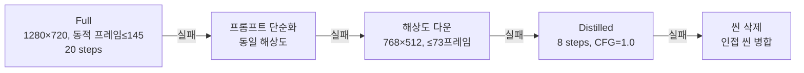
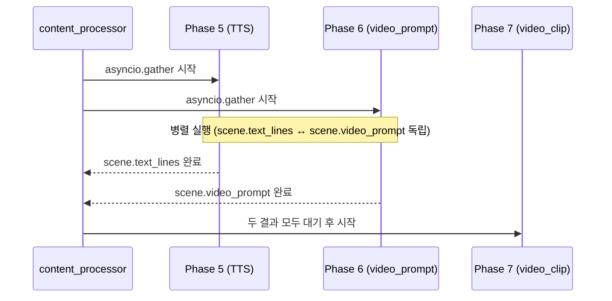
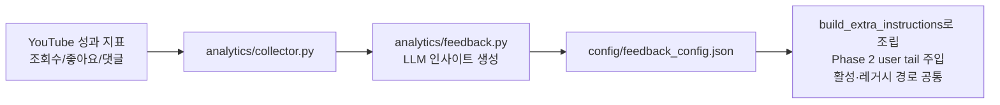

# WaggleBot — 파이프라인 런타임 동작

> last-verified: 2026-11-27 · code-ref: `worker/ai_worker/core/main.py`, `worker/ai_worker/core/processor.py`, `worker/ai_worker/renderer/`
> scope: ai_worker 처리 루프, 4단계 폴백, 피드백 루프, Phase5‖6 병렬 시퀀싱 — SSOT

## 처리 루프

`ai_worker/core/processor.py`:

1. `Post.status == APPROVED` 폴링 (`AI_POLL_INTERVAL=10초`). `again_spring`은 `MARKETING_CRITICAL`로 일반 잡보다 먼저 선택하며 렌더 대기열도 priority 순서다.
2. 상태 → `PROCESSING` 전환
3. 8-Phase 실행 (`content_processor.py`)
4. 성공 → `PREVIEW_RENDERED` / `RENDERED`
5. 실패 → `FAILED`, `retry_count++`, `MAX_RETRY_COUNT=3` 초과 시 영구 FAILED
6. **하트비트**: 워커가 소유한 post(LLM+TTS → 렌더 큐 대기 → 렌더)는 `_heartbeat_loop`가 `HEARTBEAT_INTERVAL_SEC`(30s)마다 `last_heartbeat_at`·`updated_at`만 원자적으로 갱신한다(`touch_runtime_heartbeat`, JSON_SET — 단계/문구 불변). 큐·GPU 락 대기, 렌더 중에도 '살아있음'이 보인다. 단, 같은 phase에서 진행 표시(`progress.stamped_at` — `stamp_progress`만 갱신)가 `PHASE_STALL_SEC`(기본 7200s)를 넘으면 해당 post의 하트비트 갱신을 멈추고 경고 로그만 남긴다(`done=true` 큐 대기·`stamped_at` 없는 레거시 행은 제외; 소유 코루틴은 취소하지 않으며 inflight는 회수 대상에서도 계속 제외). 소유자 없는 고착 PROCESSING은 `_stale_reclaim_loop`/시작 시 `reclaim_stuck_posts`가 회수한다([shared/60-runtime.md](../shared/60-runtime.md)). APPROVED 폴링의 DB 오류는 로그 후 다음 주기에 재시도한다(워커 태스크 종료 방지). Phase 경계에서도 `posts.updated_at`와 `content_runtime_state(progress).last_heartbeat_at`을 갱신한다. 진행률·Phase 7 체크포인트·SLA·품질 진단은 키별 원자적 upsert라 장시간 렌더 세션과 충돌하지 않는다.

렌더 단계는 진행률을 별도 세션으로 저장한 직후 기존 읽기 트랜잭션을 종료하고 최신 `contents` 행을 다시 읽는다. 마케팅 deadline 상태 저장이 같은 행의 오래된 스냅샷을 커밋해 MariaDB errno 1020으로 렌더를 실패시키는 것을 방지한다.

기존 `contents.pipeline_state`는 롤링 업그레이드 중 읽기 폴백만 유지한다.

**TTS 서버 장애 보류·재큐 (Local-TTS, [ADR-0006](../shared/90-adr/0006-local-tts-provider.md)):** TTS는 외부 Local-TTS 서버 요청이며 게이트·GPU 임대·컨테이너 제어·`docker.sock`은 없다. 서버 장애는 post를 FAILED로 만들지 않는다. (1) **집기 전 보류:** `_llm_tts_worker`는 APPROVED를 집기 전에 `wait_for_tts_server(timeout_sec=3)`로 `/readyz`를 비차단 확인해 실패하면 post를 집지 않고(PROCESSING·gpu_lock·retry_count 보존) `max(AI_POLL_INTERVAL, 30s)` 후 재확인한다(보류/재개 전환 로그는 상태 변화 시에만 INFO, 단 준비 확인 성공 시 `Local-TTS 서버 준비 완료`가 집기 폴링마다 INFO로 찍힌다. 확인 중 예외는 fail-open). 워커 기동 시에도 같은 비차단 확인만 하고 서버가 없어도 기동은 계속한다. (2) **처리 중 재큐:** `synthesize()`가 job 완료를 `TTS_SERVER_MAX_WAIT_SEC`(기본 3600s, **완료 대기 전용**) 안에 얻지 못하거나 HTTP 재시도(`TTS_SERVER_RETRIES`, 연결 실패는 수 초 내 소진)가 소진돼 `TTSUnavailable`을 던지면 `_run_llm_tts_supervised`가 `retry_count`를 시작 전 값으로 복원한 채 `PROCESSING → APPROVED`로 되돌리고, 다시 곧바로 집지 않도록 30초 대기한다. **연속 재큐 상한·백오프:** 같은 글의 연속 재큐 횟수를 `posts.last_error` 선두 마커 `[tts_requeue n=N at=epoch]`에 기록한다(스키마 변경 없음, `core/tts_requeue.py`; 1시간 지나면 만료). `_pick_next_approved()`는 백오프(30s·60s·120s·… 최대 600s, `TTS_REQUEUE_BACKOFF_*`) 중인 글을 건너뛰고 뒤 APPROVED를 먼저 처리하며, `TTS_REQUEUE_MAX`(기본 5)회째 연속 불가면 `FAILED`(`TTS_UNAVAILABLE_EXHAUSTED`)로 마킹한다(렌더 중 재큐도 같은 카운트). 대본·확정 보이스(`contents.summary_text`·`tts_voice`)는 TTS **전에** 저장되므로 재큐돼도 LLM을 다시 부르지 않는다. 서버 500류 오류(replay된 failed job 포함)는 총 2회 시도(2회차 새 키 `-r1`) 후 `TTSError`(FAILED 경로)이며, 연결 실패·429·503·502/504·대기초과만 `TTSUnavailable`이다. **보이스 확정:** 낭독 보이스는 `llm_tts_stage`에서 `resolve_voice(키, post_id)`로 한 번 프리셋(M1~F5)으로 확정해 `contents.tts_voice`·`ScriptData.narrator_voice`에 저장하고, SceneDirector(내레이터·댓글 풀 제외 비교)·렌더러(outro/댓글 캐시 키·합성)가 모두 같은 `(키, post_id)`로 해석해 한 영상의 목소리가 일치한다. 렌더 단계에서 댓글/아웃트로 TTS 폴백이 `TTSUnavailable`이면 같은 방식으로 APPROVED 재큐하고, `TTSError`(재시도 후에도 청크 합성 실패)는 무음 클립으로 넘기지 않고 렌더를 실패시켜 `FAILED`+`last_error`로 남긴다(빈 텍스트 청크만 건너뜀). job 완료 대기 상한의 SSOT는 `TTS_SERVER_MAX_WAIT_SEC` 하나이며 processor에는 별도 대기 루프가 없다. 요청·응답·오류 표 전체는 [local-tts-client.md](30-components/local-tts-client.md). 요청 거부·job 영구 실패(`TTSError`)와 정규화 후 빈 텍스트(`ValueError`)는 일반 실패 경로다. GPU 락은 영상 생성(Phase 7)과의 직렬화 용도만 남는다. 상세는 [pipeline.md Phase 5](30-components/pipeline.md).

## Again Spring 마케팅 고속 경로

- 외부 요청이 `preScripted=true`이면 원격 Claude 청킹을 건너뛰고 제목/본문을 로컬 문장 분할해 TTS로 보낸다. Claude는 원격 호출이므로 GPU 락을 점유하지 않으며 비디오 구간만 같은 GPU 락을 사용한다(TTS는 외부 서버 요청).
- `deadlineAt`을 넘긴 critical 작업은 `FAILED`로 고정하지 않고 `content_runtime_state(sla)`에 degraded 사유를 남긴다. `MARKETING_CRITICAL` 작업도 마감 시각이 지났다는 이유만으로 댓글 수를 줄이지 않는다. pre-scripted 마케팅 렌더의 댓글 정책은 SLA와 무관하게 좋아요 상위 2개(동률은 댓글 ID)다.
- 댓글 보이스는 작성자 해시로 결정적으로 선택하며 프리셋(M1~F5)/text 키의 전역 WAV 캐시(감정 마커 폐기로 emotion 키 없음)를 Reels·Shorts 재시도 간 공유한다.
- 본문 길이 품질 게이트는 hook·사연·CTA의 narrator WAV만 대상으로 한다. 댓글 2개와 아웃트로는 별도 tail이며 `generation_diagnostics`에 본문/댓글/아웃트로/최종 MP4 길이를 남긴다.

## 게시글별 video_gen 오버라이드

`processor.video_gen_enabled_for_post(post_id)`가 Phase 4.5~7 실행 여부를 결정한다:
`contents.variant_config.video_gen`(bool)이 존재하면 그 값을 우선 적용하고, 없으면 전역
`VIDEO_GEN_ENABLED`를 따른다. 외부 연동 ingest(`POST /api/external/jobs`)의 `options.videoGen`이
이 값을 채운다 — 예: Again Spring 사연은 기본 `video_gen=false`(정적 렌더링만).
동일하게 `processor._resolve_post_outro_text(post_id)`가 `variant_config.outro_text`를 읽어
`SceneDirector(..., outro_text=...)`로 전달하면 Phase 4의 아웃트로 문구 `random.choice()`를 건너뛴다.
Again Spring ingest의 고정 문구는 일반 사연 `여러분은 어떻게 생각하세요? 댓글로 알려주세요.`,
짝 사연 `상대방의 사연도 궁금하시죠? 댓글에서 확인해 보세요.`이다.

## 렌더 발화 싱크

Phase 8은 통합 narrator WAV를 글자 수로 나누지 않는다. `tts/alignment.py`가 faster-whisper의
단어 타임스탬프와 원문 줄을 대조해 실제 발화 시작을 구하고, 신뢰도 0.55 이상일 때만 그
경계를 사용한다. 정렬 실패는 안전하게 장면별 TTS로 폴백한다.

faster-whisper import 전 `config.settings.configure_huggingface_cache()`가 HF/Xet/XDG cache를
모두 `WHISPER_DOWNLOAD_ROOT` 하위로 설정하고 Xet을 비활성화한다. 이 설정은 uid 1000
ai_worker가 root의 `/.cache/huggingface/xet`에 쓰려다 실패하는 것을 막는다.

- 첫 줄은 영상 시작부터 표시한다. 첫 narrator PCM의 native lead를 `-45 dBFS`/3-frame 기준으로
  측정하고 150ms에 부족한 시간만 prepend한다. 원본 lead가 더 길면 trim하지 않는다.
- 이후 줄은 음성 타임라인을 바꾸지 않고 화면만 150ms 먼저 전환한다. text_only는 최대 3줄을
  순차 누적하고 다음 묶음에서 초기화한다.
- 마지막 댓글 발화 뒤 기존 화면을 250ms 유지한 뒤 클로징 텍스트를 표시한다. outro WAV의 선행
  silence는 PCM `-45 dBFS` threshold와 3-frame debounce로 측정하고 부족분만 prepend하여, 텍스트 뒤
  실제 첫 음절이 약 150ms에 오게 한다. WAV 음성/내부 휴지는 trim하지 않으며 발화 뒤 500ms 여백을 둔다.
- 최종 FFmpeg mux는 합성 오디오 총 길이로 `-t`/`-shortest`를 적용한다. 정적 PNG concat은 terminal
  PNG를 중복하지 않고 `tpad=stop_mode=clone:stop=-1`로 마지막 프레임을 유지하며 CFR 30fps로 출력한다.
- `processor._safe_generate_tts()` 디스크 캐시는 `프리셋:text:speed:pp_v7`를 사용한다. Local-TTS 전환으로 구 `pp_v6`(Fish) 결과를 재사용하지 않는다. 렌더 타이밍 정렬(`tts/alignment.py`, faster-whisper ASR)은 이번 전환에서 **유지**했으며, Local-TTS 응답 `chunks[]` 기반 전환은 후속 과제다.

**#449 실측 검증 (2026-08-05):** 31.122336초 narrator WAV의 연속 26줄을
small/int8 CPU alignment으로 정렬했을 때 confidence `1.0`을 얻었다. 첫 150ms lead를 포함한
split+merge 결과는 31.272336초였고, lead를 제외한 소스 대비 peak/RMS 차이는 모두 `-inf dB`
(sample-identical)였다. 즉 정렬 분할·재결합은 음성 파형을 변형하지 않는다.

**정적 mux 실측 검증 (2026-08-05):** 원격 2-frame actual renderer smoke에서 video stream은
`4.666667s`/140 frames @30fps, audio stream은 `4.688844s`, container format duration은
`4.689s`였다. stream 차이는 `22.177ms`로 30fps 한 frame(`33.333ms`) 미만이며, extra tail이나
early video end가 없음을 확인했다.

**운영 #454 실측 검증 (2026-08-05):** native narrator lead `0.118s`에 부족한 `0.032s`만
prepend했다. 최종 MP4의 첫 text→speech silence는 `0.149592s`, outro text→speech는
`0.150159s`였다. video `55.766667s`/1673 frames @30fps, audio `55.770000s`, 차이
`3.333ms`이며 integrated loudness `-16.7 LUFS`, true peak `-1.5 dBFS`를 확인했다.

## Phase 7 — 4단계 폴백 (video_clip 생성)

`video_gen_enabled_for_post(post_id)`가 `true`일 때만 실행. ComfyUI LTX-2 실패 시 순차 폴백:

<!-- last-verified: 2026-11-27 -->
<!-- code-ref: worker/ai_worker/core/main.py, worker/ai_worker/core/processor.py, worker/ai_worker/renderer/ -->

- `video_prompt_simplified`(앵커 유지)를 F2에서 사용
- F4에서도 실패하면 해당 씬을 삭제하고 인접 씬을 병합하여 파이프라인 계속
- LTX-2 프레임 규칙: `1+8k` (9~145) — `video_utils.validate_frame_count()` 필수 → [ADR-0004](../shared/90-adr/0004-clip-4-6s-frames-145.md)

## Phase 5‖6 병렬 시퀀싱

`VIDEO_GEN_ENABLED=true`일 때 `asyncio.gather(tts_phase(), video_prompt_phase())`로 동시 실행.

<!-- last-verified: 2026-11-27 -->
<!-- code-ref: worker/ai_worker/core/main.py, worker/ai_worker/core/processor.py, worker/ai_worker/renderer/ -->

- Phase 5는 `scene.text_lines`, Phase 6은 `scene.video_prompt`만 변경 → 뮤텍스 불필요
- GPU Phase(ComfyUI)를 병렬에 포함 **금지**(TTS는 외부 Local-TTS 서버 요청이라 Phase 5로 병렬에 포함됨) → [ADR-0003](../shared/90-adr/0003-phase56-parallel.md)

## 피드백 루프

<!-- last-verified: 2026-11-27 -->
<!-- code-ref: worker/ai_worker/core/main.py, worker/ai_worker/core/processor.py, worker/ai_worker/renderer/ -->

> 피드백 주입은 `analytics.feedback.build_extra_instructions()`를 경유한다. extra_instructions + mood_weights>1.1 선호 mood 힌트 + A/B variant_config를 합쳐 Phase 2(chunk)·레거시(generate_script) 양 경로의 user tail에 붙인다.

> Post 상태 전이 → [`docs/shared/60-runtime.md`](../shared/60-runtime.md)
> Phase별 책임 → [`docs/worker/30-components/pipeline.md`](30-components/pipeline.md)
